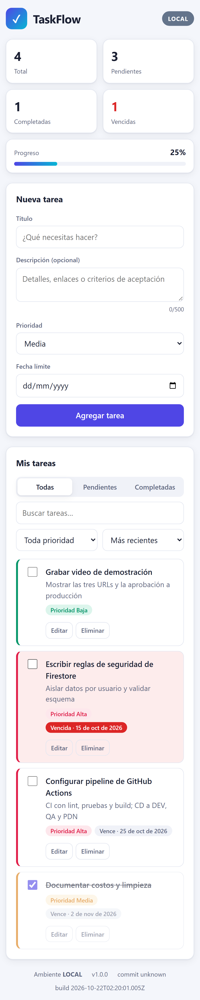
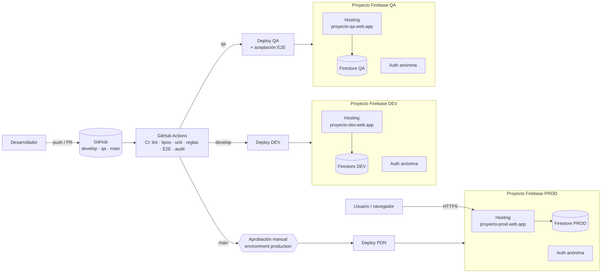
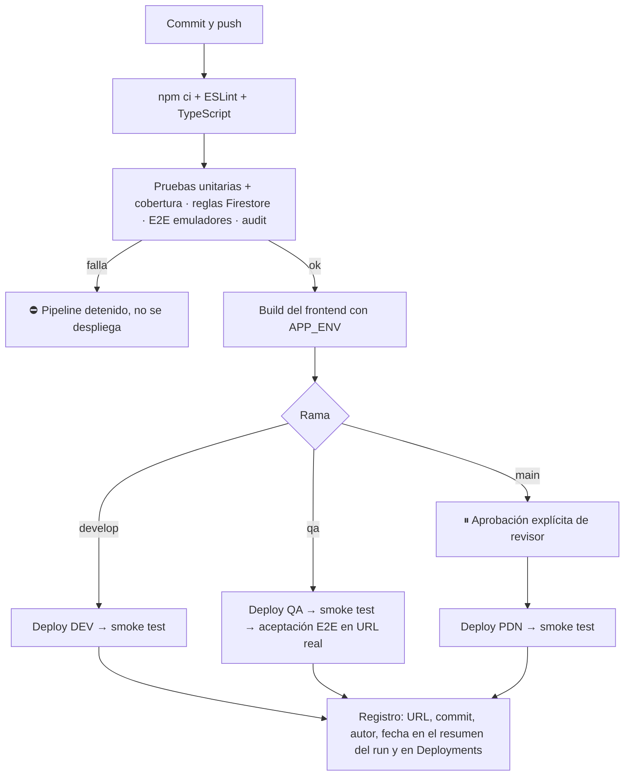

# TaskFlow · Despliegue cloud con CI/CD en tres ambientes

Aplicación web de gestión de tareas (React + TypeScript + Vite) con persistencia real en **Cloud Firestore**, publicada en **Firebase Hosting** en tres ambientes independientes (**DEV, QA y PRODUCCIÓN**) mediante un pipeline de **GitHub Actions** con pruebas que bloquean despliegues fallidos, promoción controlada entre ramas y aprobación explícita para producción.

> Taller práctico *Despliegue de aplicaciones e infraestructura en la nube* — Electiva Laboratorio DevOps.
> Modalidad B (proyecto propio) · Plataforma principal: **Firebase** (Hosting + Firestore + Auth) · Orquestación CI/CD: **GitHub Actions**.

---

## 1. Entrega (formato del taller)

| Campo | Respuesta |
|---|---|
| Integrantes | _[Carlos Daniel Quintero, Geronimo Valencia Gonzalez, Mariana Duarte Castro, Sofia Salgado Osorio, Maria Fernanda Valencia Noreña]_ |
| Modalidad | Proyecto propio (Modalidad B) |
| Plataforma principal | Firebase (Hosting + Cloud Firestore + Authentication) con CI/CD en GitHub Actions |
| Repositorio | https://github.com/MariaFernanda1818/devops-cloud-deployment |
| URL DEV | https://taskflow-dev-mf1818.web.app |
| URL QA | https://taskflow-qa-mf1818.web.app |
| URL PDN/Producción | https://taskflow-prod-mf1818.web.app |
| API DEV / QA / PDN | No aplica como API REST propia: arquitectura serverless. La API es Cloud Firestore de cada proyecto (ver §3). |
| Base de datos y persistencia | Cloud Firestore, una base por ambiente en proyectos Firebase separados. Acceso protegido por reglas de seguridad y autenticación anónima. |
| Pipeline | https://github.com/MariaFernanda1818/devops-cloud-deployment/actions |
| Costos y limpieza | Plan gratuito Spark, sin facturación habilitada (ver §8 y §9) |

### Tabla de ambientes

| Ambiente | Rama | URL de la aplicación | "API" (servicio backend) | Estado |
|---|---|---|---|---|
| DEV | `develop` | _https://[proyecto-dev].web.app_ | Firestore del proyecto DEV | Pendiente de validar |
| QA | `qa` | _https://[proyecto-qa].web.app_ | Firestore del proyecto QA | Pendiente de validar |
| PDN | `main` | _https://[proyecto-prod].web.app_ | Firestore del proyecto PROD | Pendiente de validar |

> Las URLs se reemplazarán por las reales solo después de un despliegue verificado por el smoke test. No se publican URLs inventadas.

---

## 2. La aplicación

- Crear, editar, completar y eliminar tareas (título, descripción, prioridad y fecha límite).
- Sincronización en **tiempo real** con Firestore e indicador de “Sincronizando…” hasta que el servidor confirma cada cambio.
- Filtros por estado y prioridad, búsqueda, orden por fecha de creación, fecha límite o prioridad.
- Panel de estadísticas: total, pendientes, completadas, vencidas y porcentaje de avance.
- Validación en el cliente **y** en el servidor (reglas de Firestore).
- Diseño responsive (escritorio y móvil), modo oscuro automático y accesibilidad (roles ARIA, foco visible, etiquetas).
- Insignia de ambiente (LOCAL / DEV / QA / PRODUCCIÓN) y pie con versión, commit y fecha de build, para saber siempre qué está desplegado.

| Escritorio | Móvil |
|---|---|
|  |  |

_Capturas tomadas por Playwright con la app corriendo contra los emuladores de Firebase en local._

---

## 3. Arquitectura



**Decisiones clave**

| Decisión | Motivo |
|---|---|
| **Un proyecto Firebase por ambiente** (no solo tres sitios en un proyecto) | Aislamiento total: cada ambiente tiene su propia base de datos, usuarios, reglas, cuotas y credenciales. Un error en DEV no puede tocar datos de producción. |
| **Serverless (sin API Spring Boot)** | Firestore expone la API de datos directamente al cliente; la autorización se hace con **reglas de seguridad** evaluadas en el servidor de Google. Se elimina un servidor que mantener, escalar y pagar. El taller lo permite justificándolo (§2, Modalidad B). |
| **Configuración por ambiente sin secretos en el build** | La app lee su configuración de `/__/firebase/init.json`, que Firebase Hosting sirve automáticamente para el proyecto donde está desplegada. El mismo código sirve en los tres ambientes sin variables `VITE_*` por ambiente. |
| **Autenticación anónima** | Cada navegador obtiene un `uid` propio, sin formularios de registro. Las reglas restringen cada usuario a `users/{uid}/tasks`. |
| **Patrón Repository** (`TaskRepository`) | La UI no depende de Firestore: en las pruebas se usa un repositorio en memoria y en los ambientes reales, Firestore. |
| **`version.json` en cada build** | El smoke test verifica que el commit desplegado sea exactamente el que el pipeline construyó. |

**Modelo de datos (Firestore)**

```
users/{uid}/tasks/{taskId}
  title: string (1-120)       description: string (≤500)
  priority: 'low'|'medium'|'high'   dueDate: 'YYYY-MM-DD' | null
  completed: bool             createdAt: timestamp (servidor)   updatedAt: timestamp (servidor)
```

---

## 4. Pipeline CI/CD

Implementado en [`.github/workflows`](.github/workflows):

| Workflow | Disparador | Qué hace |
|---|---|---|
| [`ci.yml`](.github/workflows/ci.yml) | Todo PR, push a ramas de trabajo, y como paso previo de `cd.yml` | **Lint** (ESLint, 0 warnings) → **TypeScript** → **pruebas unitarias/componentes** con umbral de cobertura (≥85 %) → **build** · **Reglas de seguridad** contra el emulador de Firestore · **E2E** con Playwright (Chromium escritorio y móvil) contra emuladores · **npm audit** de dependencias de producción |
| [`cd.yml`](.github/workflows/cd.yml) | Push a `develop`, `qa`, `main` o ejecución manual | Ejecuta **toda la CI**; si pasa, despliega al ambiente de la rama |
| [`deploy-firebase.yml`](.github/workflows/deploy-firebase.yml) | Reutilizable | Valida la configuración → build con `APP_ENV` → `firebase deploy --only hosting,firestore` → **smoke test** → (QA) **pruebas de aceptación E2E contra la URL real** → registro del despliegue |
| [`promotion-guard.yml`](.github/workflows/promotion-guard.yml) | PR hacia `qa` o `main` | Solo permite `develop → qa` y `qa → main` (o `hotfix/*`) |

### Flujo (corresponde a la §5 del taller)



**Regla de promoción:**
1. Los cambios entran a `develop` por PR → se despliegan a **DEV**.
2. PR `develop → qa` (verificado por `promotion-guard`) → se despliega a **QA** y se ejecutan pruebas de aceptación sobre la URL real.
3. PR `qa → main` → el job de producción **queda en pausa** hasta que un revisor autorizado lo apruebe en el environment `production`.
4. Cualquier fallo de lint, tipos, pruebas, build, despliegue o smoke test detiene el pipeline.

**Smoke test** ([`scripts/smoke-test.mjs`](scripts/smoke-test.mjs)) verifica en cada ambiente: HTTPS, HTTP 200 con la app, `version.json` con el **ambiente y commit esperados** (con reintentos por propagación del CDN), cabeceras de seguridad, reescritura SPA y que `init.json` apunte al **proyecto Firebase correcto**.

**Rollback:** dos opciones.
- Ejecutar manualmente el workflow **CD** (`Run workflow`), elegir el ambiente y seleccionar como ref un tag o commit anterior. Producción solo acepta `main` o tags `v*`, y sigue exigiendo aprobación.
- Firebase Console → Hosting → historial de versiones → **Rollback**, que es instantáneo y no requiere build.

---

## 5. Pruebas

| Tipo | Herramienta | Qué cubre | Comando |
|---|---|---|---|
| Unitarias de dominio | Vitest | Validación, normalización, filtros, orden, estadísticas, fechas | `npm test` |
| Componentes | Vitest + Testing Library | Crear, validar, editar, completar, eliminar con confirmación, filtrar, ordenar, errores, sincronización | `npm test` |
| Cobertura | @vitest/coverage-v8 | Umbral mínimo: 85 % líneas/funciones, 80 % ramas | `npm run test:ci` |
| Reglas de seguridad | @firebase/rules-unit-testing + emulador | Dueño puede CRUD; anónimo/no autenticado denegado; aislamiento entre usuarios; validación de esquema; `createdAt` inmutable; colecciones no declaradas denegadas | `npm run test:rules` |
| E2E / aceptación | Playwright (escritorio + móvil) | Ciclo completo con persistencia real verificada por recarga; validación del formulario | `npm run test:e2e:emulator` (local) · `E2E_BASE_URL=... npm run test:e2e` (ambiente real) |
| Smoke post-despliegue | Node script | Ver §4 | `npm run smoke -- --url <url> --env <dev\|qa\|prod>` |

**Resultados de la ejecución local (21-oct-2026)**

| Suite | Resultado |
|---|---|
| ESLint | 0 errores, 0 warnings |
| TypeScript (`strict`) | Sin errores |
| Vitest | **35/35** pruebas OK · cobertura 98.97 % sentencias, 92 % ramas |
| Reglas de Firestore | **6/6** OK (emulador Firestore, Java 21) |
| Playwright E2E | **4/4** OK en 5 ejecuciones consecutivas (escritorio + móvil) |
| `npm audit --omit=dev` | 0 vulnerabilidades |

---

## 6. Ejecución local

Requisitos: Node 24 (`.nvmrc`) y Java 21+ (solo para los emuladores).

```bash
npm ci
npm run emulators          # terminal 1: emuladores de Auth y Firestore (UI en http://127.0.0.1:4000)
npm run dev:emulator       # terminal 2: app en http://localhost:5173 contra los emuladores
npm run verify             # lint + tipos + pruebas con cobertura + build
npm run test:rules         # reglas de seguridad
npm run test:e2e:emulator  # E2E
```

Los emuladores usan el proyecto ficticio `demo-taskflow`: no se conectan a ningún proyecto real ni requieren credenciales.

---

## 7. Seguridad

| Aspecto | Medida |
|---|---|
| Secretos | **Ningún secreto en el repositorio ni claves permanentes.** GitHub Actions se autentica en Google Cloud con **Workload Identity Federation (OIDC)**: credenciales temporales limitadas al repositorio y al environment del job. La clave JSON solo existe como alternativa documentada. `.gitignore` bloquea `.env*`, `service-account*.json` y similares. |
| Configuración web de Firebase | `apiKey`/`appId` **no son secretos** (identifican el proyecto). Se sirven desde `/__/firebase/init.json`. La protección real la dan las reglas de Firestore y la restricción de la API key por dominio (ver guía). |
| Autorización de datos | [`firestore.rules`](firestore.rules): solo el dueño (`request.auth.uid`) accede a `users/{uid}/tasks`; validación de campos, tipos, longitudes y timestamps del servidor; todo lo demás denegado. Probado automáticamente. |
| Mínimo privilegio en CI | Una cuenta de servicio por proyecto con solo 4 roles: Firebase Hosting Admin, Firebase Rules Admin, Cloud Datastore Index Admin y Service Usage Consumer. Solo los jobs del environment correspondiente pueden suplantarla. Los workflows usan `contents: read` y, en el despliegue, `id-token: write`. |
| Producción protegida | Environment `production` con revisores obligatorios; solo despliega desde `main` o tags `v*`. Ramas protegidas con checks obligatorios. |
| Cabeceras HTTP | CSP estricta (`script-src 'self'`, `frame-ancestors 'none'`), HSTS, `X-Content-Type-Options`, `X-Frame-Options: DENY`, `Referrer-Policy`, `Permissions-Policy`. Verificadas por el smoke test en cada despliegue. |
| Transporte | HTTPS obligatorio con certificado gestionado por Firebase Hosting. |
| Dependencias | `npm audit` en CI. Se aplicó `overrides` para forzar `@grpc/grpc-js ≥ 1.14.6` (CVE en la versión transitiva de Firestore). |
| Datos de producción | Solo datos de demostración; cada visitante ve únicamente sus propias tareas. |

---

## 8. Costos

Todo el proyecto está diseñado para el **plan Spark (gratuito)** de Firebase y el plan gratuito de GitHub Actions. **No se habilita facturación.** Si se supera una cuota gratuita, el servicio se limita, no se cobra.

| Servicio | Uso | Cuota gratuita relevante (Spark)* | Costo esperado |
|---|---|---|---|
| Firebase Hosting (×3) | Frontend estático | 10 GB almacenamiento, 360 MB/día de transferencia | $0 |
| Cloud Firestore (×3) | Persistencia | 1 GiB almacenado, 50 000 lecturas, 20 000 escrituras y 20 000 borrados por día | $0 |
| Firebase Authentication (anónima) | Identidad | Incluida en Spark | $0 |
| GitHub Actions | CI/CD | Ilimitado en repos públicos; 2 000 min/mes en privados | $0 |

\*Cuotas según la documentación oficial de Firebase; deben confirmarse en https://firebase.google.com/pricing al momento del despliegue.

**Recursos que podrían generar cargos** (no se usan): pasar a plan Blaze, Cloud Functions, Cloud Run, Cloud SQL, dominios personalizados de pago o exceder cuotas en Blaze. Recomendación: si algún día se activa Blaze, configurar **alertas de presupuesto** en Google Cloud Billing antes de cualquier otra cosa.

---

## 9. Limpieza de recursos al finalizar

1. **Desactivar Hosting** en cada ambiente (deja de servir la URL):
   `npx firebase hosting:disable --project <id-proyecto> --force`
2. **Eliminar los proyectos** (borra Hosting, Firestore, Auth y cuentas de servicio): Firebase Console → ⚙️ Configuración del proyecto → *Eliminar proyecto*, uno por ambiente. Google los mantiene 30 días en estado “pendiente de eliminación”.
3. **Revocar credenciales**: borrar las claves de las cuentas de servicio en Google Cloud Console → IAM → Cuentas de servicio (si el proyecto no se elimina).
4. **GitHub**: borrar los secretos `FIREBASE_SERVICE_ACCOUNT` y los environments `development`, `qa`, `production` (Settings → Environments). Deshabilitar los workflows si el repositorio queda público.

---

## 10. Configuración inicial de la infraestructura

Paso a paso para crear los tres proyectos Firebase, las cuentas de servicio, los GitHub Environments y la protección de ramas: **[docs/CONFIGURACION.md](docs/CONFIGURACION.md)**.

## 11. Estructura del repositorio

```
.github/workflows/   ci.yml · cd.yml · deploy-firebase.yml · promotion-guard.yml
src/domain/          Modelo y reglas de negocio puras (validación, filtros, estadísticas)
src/data/            TaskRepository: Firestore (producción) y en memoria (pruebas); arranque de Firebase
src/components/      UI en React (TaskBoard, TaskForm, TaskItem, TaskToolbar, StatsBar)
tests/rules/         Pruebas de reglas de seguridad de Firestore
e2e/                 Pruebas E2E / aceptación con Playwright
scripts/             Smoke test post-despliegue
firebase.json        Hosting (cabeceras, caché, SPA) + Firestore + emuladores
firestore.rules      Reglas de seguridad
docs/                Guía de configuración y evidencias
```

## 12. Limitaciones conocidas

- El **emulador local de Hosting** (firebase-tools 15.34.1) no aplicó las cabeceras personalizadas de `firebase.json` durante las pruebas locales, aunque el resto de la configuración (reescrituras, `init.json`) sí funcionó. Firebase Hosting real aplica las cabeceras en su CDN, y el smoke test del pipeline las verifica contra cada URL desplegada.
- Al no existir una API REST propia, las “URLs de API” de la tabla de entrega corresponden al servicio Cloud Firestore de cada proyecto, que no se expone como endpoint abierto.
