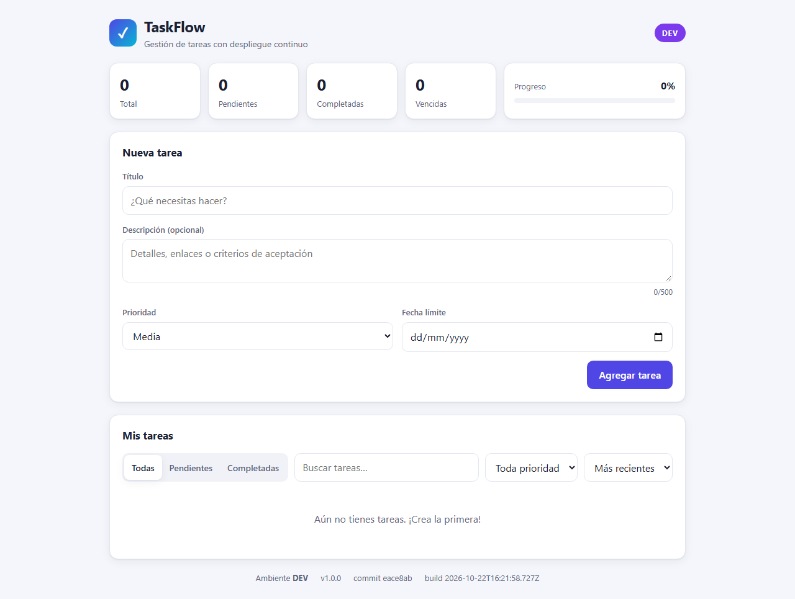
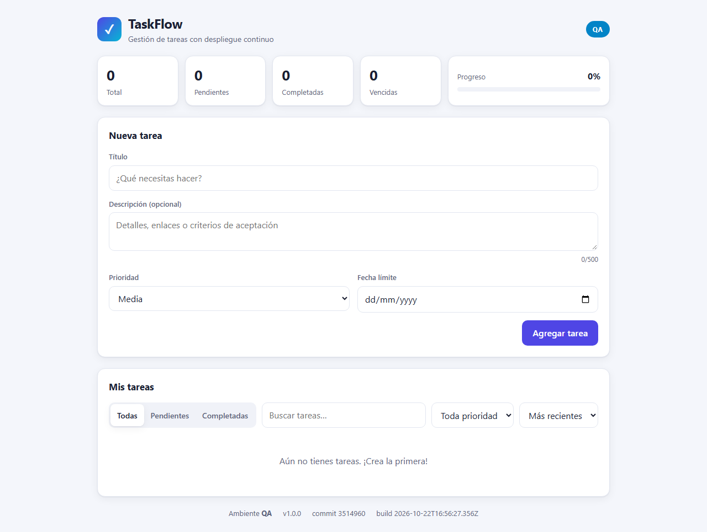
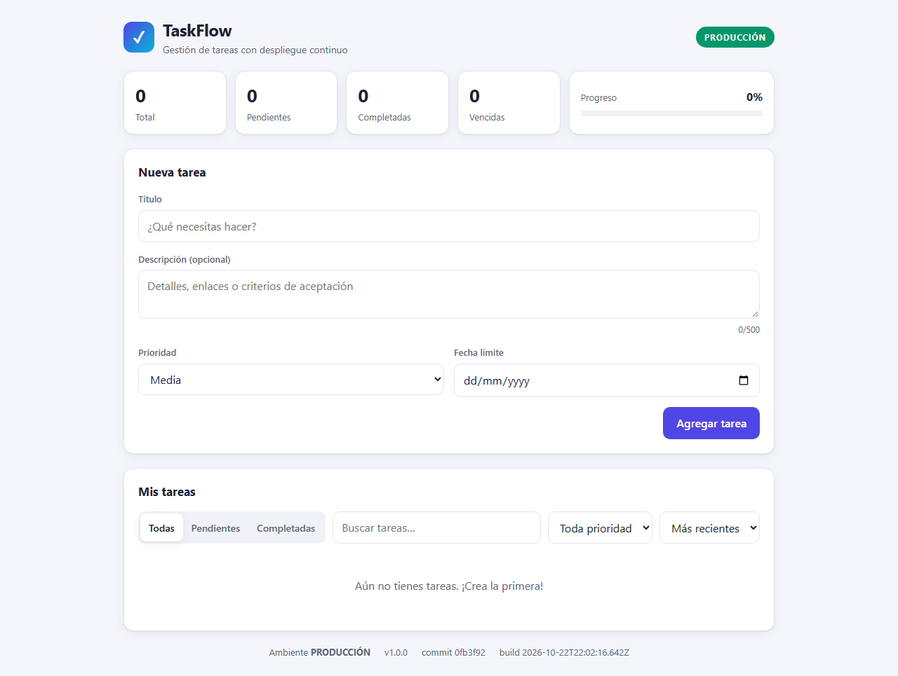
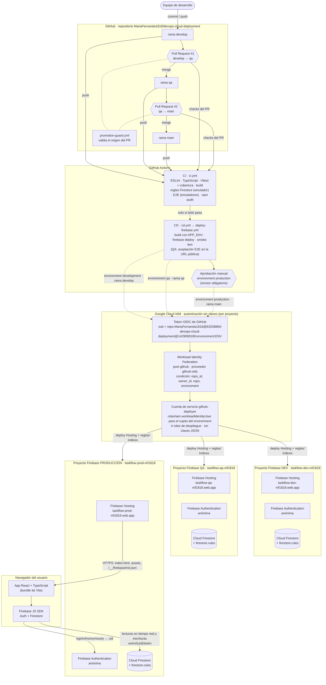
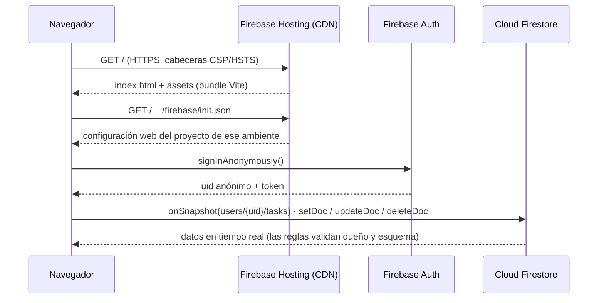
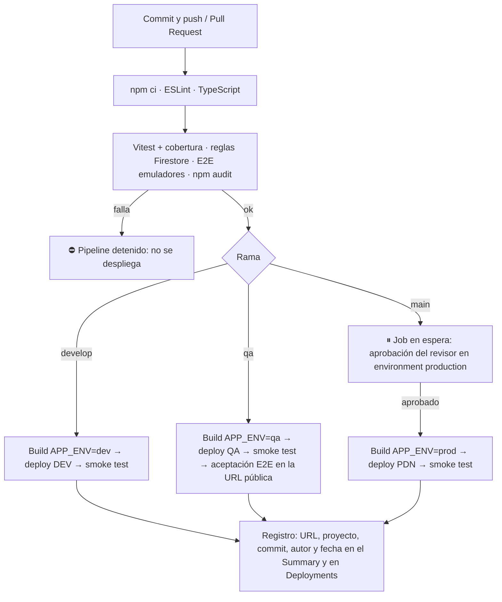
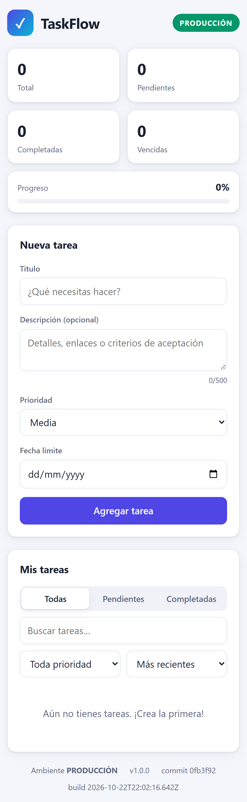
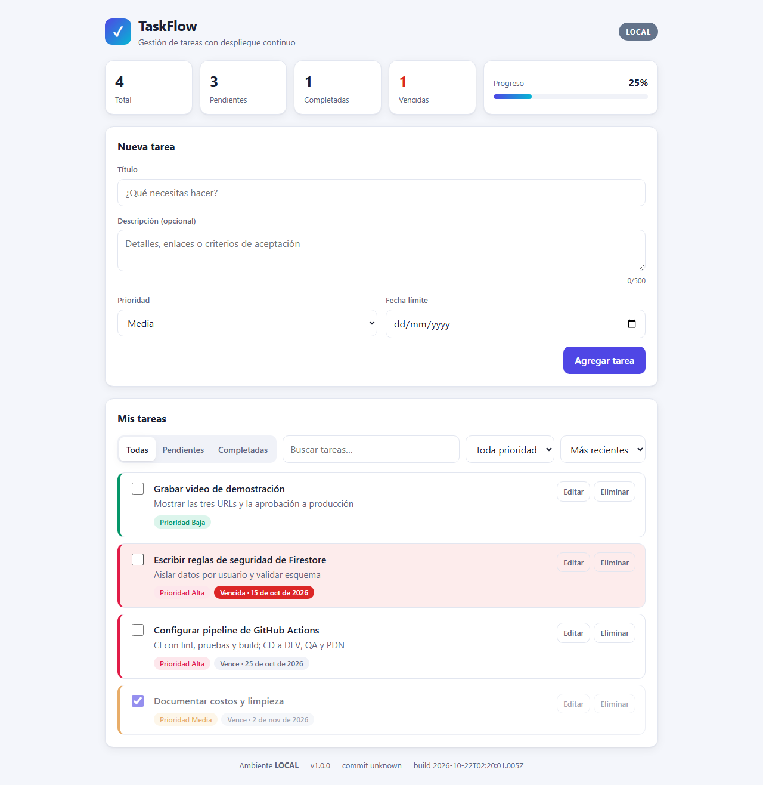

# TaskFlow · Despliegue cloud con CI/CD en tres ambientes

Aplicación web de gestión de tareas (React + TypeScript + Vite) con persistencia real en **Cloud Firestore**, publicada en **Firebase Hosting** en tres ambientes independientes: **DEV, QA y PRODUCCIÓN**.

Un pipeline de **GitHub Actions** construye y prueba la aplicación, la despliega por rama y promueve los cambios mediante Pull Requests. Producción exige **aprobación manual**. GitHub Actions se autentica en Google Cloud **sin claves**, mediante Workload Identity Federation (OIDC).

> Taller práctico *Despliegue de aplicaciones e infraestructura en la nube* · Electiva Laboratorio DevOps.
> 📄 **Documento académico de entrega:** [`docs/ENTREGA_FINAL.md`](docs/ENTREGA_FINAL.md)

**Contenido:**
[1. Entrega](#1-formato-de-entrega-del-equipo) ·
[2. Aplicación](#2-la-aplicación) ·
[3. Arquitectura](#3-arquitectura) ·
[4. Servicios](#4-servicios-utilizados) ·
[5. Pipeline](#5-pipeline-cicd) ·
[6. Pruebas](#6-pruebas-y-resultados) ·
[7. Seguridad](#7-seguridad) ·
[8. Costos](#8-costos-plan-spark) ·
[9. Limpieza](#9-desactivación-y-eliminación-de-recursos) ·
[10. Evidencias](#10-evidencias) ·
[11. Sustentación](#11-sustentación-flujo-dev--qa--producción) ·
[12. Ejecución local](#12-ejecución-local) ·
[13. Incidentes](#13-incidentes-y-lecciones-aprendidas)

---

## 1. Formato de entrega del equipo

| Campo | Respuesta del equipo |
|---|---|
| Integrantes | Carlos Daniel Quintero, Geronimo Valencia Gonzalez, Mariana Duarte Castro, Sofia Salgado Osorio, Maria Fernanda Valencia Noreña |
| Modalidad | Proyecto propio (Modalidad B) |
| Plataforma principal | Firebase (Hosting, Cloud Firestore, Authentication) + Google Cloud IAM, con CI/CD en GitHub Actions |
| Repositorio | https://github.com/MariaFernanda1818/devops-cloud-deployment |
| URL DEV | https://taskflow-dev-mf1818.web.app |
| URL QA | https://taskflow-qa-mf1818.web.app |
| URL PDN/Producción | https://taskflow-prod-mf1818.web.app |
| API DEV / QA / PDN | **No aplica como API REST propia.** Arquitectura serverless: el servicio de datos es Cloud Firestore de cada proyecto (`taskflow-dev-mf1818`, `taskflow-qa-mf1818`, `taskflow-prod-mf1818`), al que la app accede con el SDK de Firebase. Las reglas de seguridad hacen el papel de capa de autorización. No se expone como endpoint abierto (ver [§3](#3-arquitectura)). |
| Base de datos y estrategia de persistencia | Cloud Firestore (modo Native, edición Standard, ubicación `nam5`): una base `(default)` **por ambiente**, en proyectos separados. Cada usuario obtiene un `uid` anónimo y solo accede a `users/{uid}/tasks`. No se incluyen credenciales. |
| Pipeline | https://github.com/MariaFernanda1818/devops-cloud-deployment/actions · Promociones: [PR #1](https://github.com/MariaFernanda1818/devops-cloud-deployment/pull/1) (develop → qa) y [PR #2](https://github.com/MariaFernanda1818/devops-cloud-deployment/pull/2) (qa → main) · Producción: [CD #7](https://github.com/MariaFernanda1818/devops-cloud-deployment/actions/runs/39859676964), commit `0fb3f92`, con aprobación manual registrada |
| Costos y limpieza | Plan **Spark** (sin costo) y **sin cuenta de facturación vinculada** en los tres proyectos; GitHub Actions con runners estándar, sin costo en repositorios públicos. Costos potenciales y riesgos en [§8](#8-costos-plan-spark); plan de eliminación en [§9](#9-desactivación-y-eliminación-de-recursos). |

### Ambientes

| Ambiente | Rama | URL de la aplicación | Servicio de datos ("API") | Proyecto Firebase | GitHub Environment | Commit publicado | Estado |
|---|---|---|---|---|---|---|---|
| DEV | `develop` | https://taskflow-dev-mf1818.web.app | Firestore `taskflow-dev-mf1818` | `taskflow-dev-mf1818` | `development` | `2a2e390` | ✅ Verificado |
| QA | `qa` | https://taskflow-qa-mf1818.web.app | Firestore `taskflow-qa-mf1818` | `taskflow-qa-mf1818` | `qa` | `3514960` | ✅ Verificado |
| PDN | `main` | https://taskflow-prod-mf1818.web.app | Firestore `taskflow-prod-mf1818` | `taskflow-prod-mf1818` | `production` (con aprobación) | `0fb3f92` | ✅ Verificado |

*Estado verificado el 2026-10-22 (UTC-5): smoke test 7/7 contra las tres URLs públicas, ver [§6](#6-pruebas-y-resultados). Cada sitio publica su versión en `/version.json` (p. ej. https://taskflow-prod-mf1818.web.app/version.json). DEV publica `2a2e390`, que solo difiere de `eace8ab`/`3514960`/`0fb3f92` en el README: el código de la aplicación es el mismo en los tres ambientes.*

**Rúbrica del profesor → dónde está cada entregable**

| # | Entregable | Ubicación |
|---|---|---|
| 1-3 | URLs DEV, QA y Producción | [Tabla de ambientes](#ambientes) |
| 4 | Repositorio con README, instrucciones y pipeline | Este README · [`docs/ENTREGA_FINAL.md`](docs/ENTREGA_FINAL.md) · [`docs/CONFIGURACION.md`](docs/CONFIGURACION.md) · [`.github/workflows/`](.github/workflows) |
| 5 | Diagrama de arquitectura (servicios, ambientes y flujos) | [§3](#3-arquitectura) |
| 6 | Tabla de servicios, seguridad y costos potenciales | [§4](#4-servicios-utilizados), [§7](#7-seguridad), [§8](#8-costos-plan-spark) |
| 7 | Desactivación y eliminación de recursos | [§9](#9-desactivación-y-eliminación-de-recursos) |
| 8 | Formato de entrega del equipo | [§1](#1-formato-de-entrega-del-equipo) |
| 9 | Evidencias visuales | [§10](#10-evidencias) · [`docs/EVIDENCIAS.md`](docs/EVIDENCIAS.md) |

---

## 2. La aplicación

**TaskFlow** es un gestor de tareas personal:

- Crear, editar, completar y eliminar tareas, con título, descripción, prioridad y fecha límite. La eliminación pide confirmación.
- Persistencia en **Cloud Firestore** con actualización en tiempo real (`onSnapshot`). Cada tarea muestra "Sincronizando…" hasta que el servidor confirma la escritura.
- Filtros por estado y prioridad, búsqueda y orden por fecha de creación, fecha límite o prioridad.
- Estadísticas: total, pendientes, completadas, vencidas y porcentaje de avance.
- Validación en el cliente (`src/domain/task.ts`) **y** en el servidor (`firestore.rules`).
- Diseño responsive, modo oscuro automático y accesibilidad (roles ARIA, etiquetas y foco visible).
- **Trazabilidad del despliegue:** la insignia DEV / QA / PRODUCCIÓN y el pie (versión, commit y fecha de build) muestran qué está publicado en cada ambiente.

| DEV | QA | Producción |
|---|---|---|
|  |  |  |

**Estructura del código**

```
src/domain/       Modelo y reglas de negocio puras: validación, filtros, orden, estadísticas
src/data/         TaskRepository: Firestore (ambientes reales) y en memoria (pruebas); arranque de Firebase
src/hooks/        useTasks: suscripción en tiempo real y operaciones
src/components/   UI: TaskBoard, TaskForm, TaskItem, TaskToolbar, StatsBar
tests/rules/      Pruebas de las reglas de seguridad de Firestore (emulador)
e2e/              Pruebas E2E / aceptación con Playwright
scripts/          smoke-test.mjs (verificación posterior al despliegue)
firebase.json     Hosting (cabeceras, caché, SPA), Firestore y emuladores
firestore.rules   Reglas de seguridad
```

---

## 3. Arquitectura

### 3.1 Diagrama: servicios, ambientes y flujos



> El flujo del navegador se dibuja para PRODUCCIÓN y es idéntico en DEV y QA, cada uno contra su propio proyecto. Cada proyecto Firebase tiene **su propio** pool `github`, proveedor `github-oidc` y cuenta `github-deployer`; aquí se agrupan para simplificar. Las credenciales de un ambiente no sirven en otro: el proveedor exige el `environment` correspondiente. `promotion-guard` y la CI se ejecutan en cada PR, pero **no están configurados como checks obligatorios** (no hay protección de ramas; ver [§7](#7-seguridad)).

### 3.2 Flujo de una petición del usuario



### 3.3 Decisiones de arquitectura

| Decisión | Motivo |
|---|---|
| **Un proyecto Firebase por ambiente** | Aislamiento total: base de datos, usuarios, reglas, cuotas y credenciales propias. Un error en DEV no puede afectar datos de producción. |
| **Serverless, sin API Spring Boot** | Firestore expone la API de datos al cliente y la autorización se evalúa en el servidor de Google con las reglas de seguridad. No hay servidor que mantener ni pagar. El taller lo permite en la Modalidad B si se justifica. |
| **Configuración por ambiente sin variables en el build** | La app lee su configuración de `/__/firebase/init.json`, que Hosting sirve para el proyecto donde está publicada. No hay variables `VITE_*` por ambiente ni configuración web versionada. |
| **Autenticación anónima** | Cada navegador obtiene un `uid` propio sin registro, y las reglas restringen cada usuario a `users/{uid}/tasks`. |
| **Patrón Repository** (`TaskRepository`) | La UI no depende de Firestore: las pruebas usan un repositorio en memoria. |
| **`version.json` en cada build** | El smoke test confirma que el commit publicado es exactamente el que construyó el pipeline. |
| **Workload Identity Federation** | GitHub Actions obtiene credenciales temporales (~1 h) sin claves JSON permanentes. |

**Modelo de datos (Firestore)**

```
users/{uid}/tasks/{taskId}
  title: string (1-120)            description: string (≤ 500)
  priority: 'low'|'medium'|'high'  dueDate: 'YYYY-MM-DD' | null
  completed: bool                  createdAt: timestamp (servidor)   updatedAt: timestamp (servidor)
```

---

## 4. Servicios utilizados

Tabla de servicios, seguridad y costos potenciales. Las cuotas se contrastaron el 2026-10-22 con la documentación oficial enlazada en [§8](#8-costos-plan-spark).

| Servicio | Uso en el proyecto | Configuración | Seguridad | Cuota sin costo / costo actual | Costo potencial o riesgo |
|---|---|---|---|---|---|
| **GitHub Actions** | CI/CD: pruebas, build, despliegue y verificación | `ci.yml`, `cd.yml`, `deploy-firebase.yml`, `promotion-guard.yml`; environments `development`, `qa`, `production` | `permissions: contents: read`; `id-token: write` solo en el job de despliegue; `production` con revisor obligatorio; sin secretos | Runners estándar sin costo en repositorios públicos | Si el repositorio pasa a privado se consumen minutos de la cuota del plan; los *larger runners* siempre se cobran (no se usan) |
| **Firebase Hosting** | Publica el frontend estático (`dist/`) por HTTPS | Un sitio por proyecto (`*.web.app`); `firebase.json`: reescritura SPA, cabeceras, `index.html`/`version.json` sin caché, assets inmutables | HTTPS gestionado, CSP, HSTS, `X-Frame-Options: DENY`, `nosniff` | 10 GB de almacenamiento; transferencia 360 MB/día (página de precios) · 10 GB/mes (página de cuotas de Hosting) | En Spark, al superar la transferencia el sitio se deshabilita (no se cobra); en Blaze se cobra el excedente |
| **Cloud Firestore** | Persistencia de las tareas en tiempo real | Native, Standard, `nam5`; una base `(default)` por proyecto; `firestore.rules` desplegadas por el pipeline | Reglas: solo el dueño (`request.auth.uid`) accede; validación de esquema; todo lo demás denegado | 1 GiB almacenado; 50 000 lecturas, 20 000 escrituras y 20 000 borrados por día; 10 GiB/mes de salida | Un bucle de lecturas o un abuso agota la cuota diaria (en Spark se detiene el servicio); en Blaze generaría cobro |
| **Firebase Authentication** | Identidad anónima por navegador | Proveedor **Anónimo** habilitado en cada proyecto | Cada `uid` solo ve sus datos; límite de 100 cuentas nuevas por hora por IP | Incluido en Spark; límite de 100 millones de cuentas anónimas por proyecto | Las cuentas anónimas se acumulan (no se limpian automáticamente); proveedores como teléfono/SMS requieren Blaze (no se usan) |
| **Google Cloud IAM** | Identidad del pipeline | Cuenta `github-deployer` por proyecto con 4 roles: Firebase Hosting Admin, Firebase Rules Admin, Cloud Datastore Index Admin, Service Usage Consumer | Mínimo privilegio; sin claves JSON; no puede leer datos de Firestore ni cambiar IAM | La documentación consultada no publica tarifa; los proyectos no tienen cuenta de facturación | Asignar roles amplios (Editor/Owner) aumentaría el impacto de un compromiso |
| **Workload Identity Federation** | Intercambia el token OIDC de GitHub por credenciales temporales | Pool `github`, proveedor `github-oidc`, binding `roles/iam.workloadIdentityUser` al sujeto inmutable del environment | Condición: `repository_id`, `repository_owner_id`, `repository` y `environment`; credenciales de ~1 h | La documentación consultada no publica tarifa; los proyectos no tienen cuenta de facturación | Una condición demasiado amplia permitiría que otro repositorio obtenga credenciales |

## 5. Pipeline CI/CD

### 5.1 Workflows

| Workflow | Disparador | Qué hace |
|---|---|---|
| [`ci.yml`](.github/workflows/ci.yml) | Pull Requests y pushes a ramas de trabajo; además, primera etapa de `cd.yml` | 4 jobs en paralelo: **Lint, tipos, pruebas unitarias y build** (ESLint 0 warnings, `tsc` estricto, Vitest con umbral de cobertura, `vite build`) · **Reglas de seguridad de Firestore** (emulador, Java 21) · **E2E con emuladores** (Playwright, Chromium escritorio y móvil) · **Auditoría de dependencias de producción** (`npm audit --omit=dev`) |
| [`cd.yml`](.github/workflows/cd.yml) | Push a `develop`, `qa` o `main`; ejecución manual (`workflow_dispatch`) | Ejecuta la CI completa y, solo si pasa, el despliegue del ambiente de la rama. La creación de una rama no despliega. |
| [`deploy-firebase.yml`](.github/workflows/deploy-firebase.yml) | Reutilizable | Valida la configuración → build con `APP_ENV` → autenticación OIDC → `firebase deploy --only hosting,firestore:rules,firestore:indexes` → **smoke test** → (QA) **aceptación E2E contra la URL pública** → registro del despliegue |
| [`promotion-guard.yml`](.github/workflows/promotion-guard.yml) | PR hacia `qa` o `main` | Falla si el origen no es `develop → qa` o `qa → main` (o `hotfix/*`). Es un check informativo: no hay protección de ramas que lo haga obligatorio (ver [§7](#7-seguridad)). |

### 5.2 Flujo (corresponde a la §5 del taller)



| Paso del taller | Implementación |
|---|---|
| Commit y push | Ramas `develop` → `qa` → `main`, promovidas por Pull Request |
| Dependencias y análisis | `npm ci`, ESLint, TypeScript estricto, `npm audit` |
| Pruebas automatizadas | Vitest, reglas de Firestore en emulador, E2E con Playwright |
| Construcción | `npm run build` con `APP_ENV` por ambiente |
| Despliegue automático a DEV | Job DEV en push a `develop` |
| Smoke test en DEV y promoción a QA | `scripts/smoke-test.mjs` + [PR #1](https://github.com/MariaFernanda1818/devops-cloud-deployment/pull/1) `develop → qa`, con CI y `promotion-guard` en verde antes del merge |
| Pruebas de aceptación en QA | Playwright contra https://taskflow-qa-mf1818.web.app |
| Aprobación explícita antes de PDN | Environment `production` con *Required reviewers* (revisor: `MariaFernanda1818`) y bypass de administradores desactivado. En [CD #7](https://github.com/MariaFernanda1818/devops-cloud-deployment/actions/runs/39859676964) la aprobación quedó registrada; quien inició y quien aprobó fue la misma cuenta (ver [§7](#7-seguridad)) |
| Despliegue de producción y verificación | Job PRODUCCIÓN + smoke test |
| Registro de versión y evidencias | `version.json`, Summary del run, GitHub Deployments y versión de Firebase Hosting con mensaje `ENV commit run #N` |

**Regla de promoción:** cualquier fallo de lint, tipos, pruebas, build, autenticación, despliegue o smoke test detiene el pipeline (el despliegue depende de la CI con `needs: ci`). La promoción a producción no se hace copiando archivos a mano: pasa por un PR `qa → main`, la CI y la aprobación del environment. **Limitación:** las ramas no tienen reglas de protección, así que GitHub permitiría un merge o un push directo aunque los checks del PR fallaran. Lo que sí es obligatorio es la aprobación del environment `production` antes de desplegar.

### 5.3 Rollback

| Opción | Cómo | Alcance y límites |
|---|---|---|
| **Rollback de Hosting (inmediato)** | Firebase Console → proyecto → **Hosting** → historial de versiones → ⋮ en una versión anterior → **Rollback** | Vuelve a publicar una versión anterior del sitio sin compilar. **No** revierte las reglas de Firestore ni el código en Git: el siguiente despliegue del pipeline vuelve a publicar la punta de la rama. |
| **Revertir por el pipeline (recomendado)** | `git revert <commit>` en una rama de trabajo → PR a `develop` → PR `develop → qa` → PR `qa → main` → aprobación en `production` | Pasa por toda la CI, el smoke test, la aceptación en QA y la aprobación. Deja trazabilidad en Git. |
| **Volver a ejecutar el despliegue** | Actions → **CD** → *Run workflow* → elegir la rama y el ambiente | Solo vuelve a desplegar **la punta de la rama** que permite cada environment (`development`: `develop`, `qa`: `qa`, `production`: `main`). **No** permite elegir un commit anterior. `deploy-firebase.yml` también acepta tags `v*` para producción, pero el environment `production` solo admite la rama `main` y no existen tags, así que hoy esa vía no está disponible. |

## 6. Pruebas y resultados

| Tipo | Herramienta | Qué cubre | Comando |
|---|---|---|---|
| Unitarias de dominio | Vitest | Validación, normalización, filtros, orden, estadísticas y fechas | `npm test` |
| Componentes | Vitest + Testing Library | Crear, validar, editar, completar, eliminar con confirmación, filtrar, ordenar, errores y sincronización | `npm test` |
| Cobertura | @vitest/coverage-v8 | Umbral: 85 % líneas, funciones y sentencias; 80 % ramas | `npm run test:ci` |
| Reglas de seguridad | @firebase/rules-unit-testing + emulador | CRUD del dueño; acceso sin autenticación denegado; aislamiento entre usuarios; esquema; `createdAt` inmutable; colecciones no declaradas denegadas | `npm run test:rules` |
| E2E / aceptación | Playwright (escritorio + móvil) | Ciclo de vida completo con persistencia verificada por recarga; validación del formulario | `npm run test:e2e:emulator` · `E2E_BASE_URL=<url> npm run test:e2e` |
| Smoke posterior al despliegue | `scripts/smoke-test.mjs` | HTTPS, app, ambiente y commit en `version.json`, cabeceras de seguridad, sin caché en `index`/`version.json`, reescritura SPA, `projectId` correcto | `npm run smoke -- --url <url> --env <dev\|qa\|prod> [--sha <commit>] [--project <id>]` |

### 6.1 Resultados

| Suite | Resultado |
|---|---|
| ESLint | 0 errores, 0 warnings |
| TypeScript (`strict`) | Sin errores |
| Vitest | **35/35** · cobertura 98.97 % sentencias, 92.3 % ramas |
| Reglas de Firestore (emulador) | **6/6** |
| Playwright E2E con emuladores | **4/4** (2 pruebas × escritorio y móvil) |
| Aceptación E2E contra QA pública | ✅ en [CD #5](https://github.com/MariaFernanda1818/devops-cloud-deployment/actions/runs/39817039305) |
| `npm audit --omit=dev` | 0 vulnerabilidades |
| Smoke test contra DEV, QA y PDN (2026-10-22) | **7/7** en cada ambiente |

### 6.2 Runs de GitHub Actions

| Run | Rama / evento | Commit | Resultado | Qué demuestra |
|---|---|---|---|---|
| [CD #1](https://github.com/MariaFernanda1818/devops-cloud-deployment/actions/runs/39720368963) | `develop` · push | `139372d` | ❌ | Un fallo de autenticación **detuvo** el pipeline: no se publicó nada (ver [§13](#13-incidentes-y-lecciones-aprendidas)) |
| [CD #2](https://github.com/MariaFernanda1818/devops-cloud-deployment/actions/runs/39720712127) | `develop` · push | `bb6e8d8` | ✅ (intento 4) | Primer despliegue DEV, tras corregir el principal de WIF; los intentos 1 a 3 fallaron por el formato del `sub` |
| [CD #3](https://github.com/MariaFernanda1818/devops-cloud-deployment/actions/runs/39813146037) | `develop` · push | `eace8ab` | ✅ | Despliegue DEV de la versión promovida |
| [CD #4](https://github.com/MariaFernanda1818/devops-cloud-deployment/actions/runs/39813685476) | `qa` · creación de rama | `b5b4859` | ✅ | Crear `qa` ejecutó la CI pero **no** desplegó |
| [CI #1](https://github.com/MariaFernanda1818/devops-cloud-deployment/actions/runs/39813973370) · [Promotion guard #1](https://github.com/MariaFernanda1818/devops-cloud-deployment/actions/runs/39813973180) | PR [#1](https://github.com/MariaFernanda1818/devops-cloud-deployment/pull/1) `develop → qa` | `eace8ab` | ✅ | Validaciones de la promoción a QA |
| [CD #5](https://github.com/MariaFernanda1818/devops-cloud-deployment/actions/runs/39817039305) | `qa` · manual | `3514960` | ✅ (intento 2) | Despliegue QA con smoke test y **aceptación E2E en la URL pública**; el intento 1 se detuvo en "Validar configuración del ambiente" |
| [CD #6](https://github.com/MariaFernanda1818/devops-cloud-deployment/actions/runs/39858080694) | `main` · creación de rama | `b5b4859` | ✅ | Crear `main` ejecutó la CI pero **no** desplegó producción |
| [CI #2](https://github.com/MariaFernanda1818/devops-cloud-deployment/actions/runs/39858134394) · [Promotion guard #2](https://github.com/MariaFernanda1818/devops-cloud-deployment/actions/runs/39858134463) | PR [#2](https://github.com/MariaFernanda1818/devops-cloud-deployment/pull/2) `qa → main` | `3514960` | ✅ | Validaciones de la promoción a producción |
| [CD #7](https://github.com/MariaFernanda1818/devops-cloud-deployment/actions/runs/39859676964) | `main` · push (merge del PR #2) | `0fb3f92` | ✅ | CI → **espera de aprobación** (CI terminada 21:45:39 UTC; job iniciado 22:01:55 UTC) → aprobación del environment `production` registrada por `MariaFernanda1818` → despliegue PDN → smoke test. La misma cuenta fusionó el PR #2, inició el run y aprobó: **no hubo separación de funciones** |

| [CD #8](https://github.com/MariaFernanda1818/devops-cloud-deployment/actions/runs/39881991716) · CD #9 · [CD #10](https://github.com/MariaFernanda1818/devops-cloud-deployment/actions/runs/39882366466) | `develop` · push (ediciones del README desde GitHub) | `11d48e4` · `9812b67` · `2a2e390` | ✅ · cancelado · ✅ | Redespliegues de DEV por cambios de documentación. CD #9 quedó cancelado porque llegó CD #10 al mismo grupo de concurrencia (`cd-develop`) mientras esperaba |

El contenido de `main` (`0fb3f92`) es idéntico al validado en QA (`3514960`): `git diff 3514960 0fb3f92` no muestra cambios.

---

## 7. Seguridad

| Aspecto | Medida |
|---|---|
| Secretos | **Ningún secreto en el repositorio ni claves permanentes.** El pipeline se autentica con Workload Identity Federation y los GitHub Environments solo guardan identificadores no sensibles (`FIREBASE_PROJECT_ID`, `GCP_WORKLOAD_IDENTITY_PROVIDER`, `GCP_SERVICE_ACCOUNT`). `.gitignore` bloquea `.env*`, `service-account*.json` y `gha-creds-*.json`. |
| Confianza OIDC | La condición del proveedor exige `repository_id == 1429098189`, `repository_owner_id == 83258884`, `repository == MariaFernanda1818/devops-cloud-deployment` y el `environment` del proyecto. La cuenta de servicio solo acepta el sujeto inmutable de ese environment. Los jobs de CI (sin environment) no pueden obtener credenciales. |
| Mínimo privilegio | `github-deployer` tiene solo: Firebase Hosting Admin, Firebase Rules Admin, Cloud Datastore Index Admin y Service Usage Consumer. Cada rol está justificado en [`docs/CONFIGURACION.md` §2.3](docs/CONFIGURACION.md). No puede leer datos de Firestore, cambiar IAM, habilitar APIs ni tocar facturación. |
| Producción protegida | Environment `production`: revisor obligatorio (`MariaFernanda1818`), bypass de administradores desactivado y solo la rama `main` como origen de despliegue. El job no inicia (ni obtiene credenciales) hasta la aprobación. El workflow también valida que la ref sea `main` o un tag `v*`; el environment es más restrictivo y solo admite `main`. |
| Separación de funciones | **No existe.** El equipo configuró un único revisor, la misma cuenta que fusiona los PR, y *Prevent self-review* está desactivado. En CD #7 la aprobación existió, pero la hizo la misma cuenta que inició el despliegue. Mejora recomendada: agregar como revisor a otro integrante o al docente y activar *Prevent self-review*. |
| Promoción controlada | `promotion-guard` valida el origen de cada PR (develop → qa → main) y crear una rama no despliega. **No hay reglas de protección de ramas ni rulesets** en `develop`, `qa` ni `main` (verificado por la API de GitHub el 2026-10-22), así que los checks no son obligatorios para hacer merge y se permite el push directo. En los dos PR de promoción todos los checks estaban en verde antes del merge. Mejora recomendada: [`docs/CONFIGURACION.md` §3.4](docs/CONFIGURACION.md). |
| Autorización de datos | [`firestore.rules`](firestore.rules): solo el dueño (`request.auth.uid`) accede a sus tareas; valida campos, tipos, longitudes y timestamps del servidor; lo demás se deniega. Probado automáticamente (6 pruebas). |
| Cabeceras HTTP | CSP estricta (`script-src 'self'`, `frame-ancestors 'none'`), HSTS, `X-Content-Type-Options`, `X-Frame-Options: DENY`, `Referrer-Policy` y `Permissions-Policy`. El smoke test las verifica en cada despliegue. |
| Configuración web de Firebase | `apiKey`/`appId` no son secretos: identifican el proyecto y se sirven desde `/__/firebase/init.json`. La protección real la dan las reglas. |
| Dependencias | `npm audit` en CI. `overrides` fuerza `@grpc/grpc-js ≥ 1.14.6` (vulnerabilidad en la versión transitiva de Firestore). |

---

## 8. Costos (plan Spark)

Los tres proyectos Firebase usan el plan **Spark (sin costo)** y **no tienen cuenta de facturación vinculada**. Según la documentación de Firebase, en Spark, al superar la cuota sin costo de un producto **se detiene el uso de ese producto** hasta el siguiente ciclo, en lugar de cobrarse. Por lo tanto, el costo esperado del proyecto **en su configuración actual** es $0. **No es una garantía para otros escenarios:** cualquier cambio de plan o de configuración (ver abajo) puede generar cobros.

Cuotas sin costo **por proyecto**, contrastadas el 2026-10-22 con la documentación oficial:

| Servicio | Cuota sin costo (Spark) | Fuente |
|---|---|---|
| Firebase Hosting | Almacenamiento: 10 GB · Transferencia: 360 MB/día según la página de precios; 10 GB/mes según la página de cuotas de Hosting | [Precios](https://firebase.google.com/pricing) · [Cuotas de Hosting](https://firebase.google.com/docs/hosting/usage-quotas-pricing) |
| Cloud Firestore (Standard) | 1 GiB almacenado · 50 000 lecturas/día · 20 000 escrituras/día · 20 000 borrados/día · 10 GiB/mes de salida de red · una base de datos sin costo por proyecto | [Precios](https://firebase.google.com/pricing) · [Cuotas de Firestore](https://firebase.google.com/docs/firestore/quotas) |
| Firebase Authentication | Autenticación anónima incluida en Spark; hasta 100 millones de cuentas anónimas por proyecto; 100 cuentas nuevas por hora por IP | [Precios](https://firebase.google.com/pricing) · [Límites de Auth](https://firebase.google.com/docs/auth/limits) |
| GitHub Actions | Runners estándar sin costo en repositorios públicos | [Facturación de GitHub Actions](https://docs.github.com/en/billing/concepts/product-billing/github-actions) |
| Google Cloud IAM / Workload Identity Federation | Las páginas consultadas no publican una tarifa; sin cuenta de facturación vinculada no hay forma de cobro | [Workload Identity Federation](https://cloud.google.com/iam/docs/workload-identity-federation) |

Las cuotas pueden cambiar. Las dos páginas oficiales de Hosting dan cifras de transferencia distintas, así que se citan ambas.

**Escenarios que sí pueden generar cobros:**
- **Vincular una cuenta de facturación** convierte automáticamente el proyecto al plan **Blaze** (pago por uso). Desde ese momento se cobra lo que exceda las cuotas sin costo.
- En Blaze, **las alertas de presupuesto no limitan el gasto**: solo avisan. Firebase ofrece topes de gasto únicamente para algunos productos (AI Logic, App Hosting, Cloud Functions y Extensions), no para Hosting ni Firestore.
- Errores que en Blaze se convertirían en costo: reglas de Firestore demasiado abiertas, bucles de lecturas en tiempo real o picos de tráfico.
- Servicios que requieren Blaze y que este proyecto **no** usa: Cloud Functions, Cloud Run, Cloud Build, Artifact Registry, Cloud SQL y SMS de Authentication, entre otros.
- GitHub Actions: si el repositorio pasara a privado se consumirían minutos de la cuota del plan; los *larger runners* siempre se cobran.

**Mitigación si algún día se activa Blaze:** crear antes un presupuesto con alertas (50/90/100 %), revisar las reglas de Firestore y monitorear el uso en la consola de cada proyecto.

---

## 9. Desactivación y eliminación de recursos

Hazlo en este orden. Los pasos 2 a 5 son **irreversibles o difíciles de revertir**; ejecútalos solo después de la calificación.

**1. Guardar evidencias** (antes de tocar nada)
- Completar las capturas de [`docs/EVIDENCIAS.md`](docs/EVIDENCIAS.md) en `docs/evidencias/` y hacer commit.
- Descargar los logs de los runs clave (CD #5 y CD #7): en cada run, ⚙️ → *Download log archive*. Los logs caducan según la retención de Actions (90 días por defecto).
- Capturar, en Firebase Console → Hosting, el historial de versiones de cada proyecto. Al eliminar un proyecto se pierden su historial y sus datos.

**2. Detener las automatizaciones** (evita despliegues accidentales mientras se limpia)
- GitHub → **Actions** → workflow **CD** → ⋯ → **Disable workflow**. Repetir con **CI** y **Promotion guard**, o desactivar todo en **Settings → Actions → General → Disable actions**.
- **Settings → Environments:** eliminar `development`, `qa` y `production`, con sus variables.

**3. Desactivar Hosting** (la URL deja de servir la app; se revierte con un nuevo deploy):

```bash
npx firebase hosting:disable --project taskflow-dev-mf1818 --force
npx firebase hosting:disable --project taskflow-qa-mf1818 --force
npx firebase hosting:disable --project taskflow-prod-mf1818 --force
```

**4. Revocar el acceso del pipeline** (Cloud Shell, por cada proyecto; ejemplo para DEV). Eliminar el proyecto también lo haría, pero así el acceso queda cortado de inmediato:

```bash
PROJECT_ID=taskflow-dev-mf1818
gcloud iam workload-identity-pools providers delete github-oidc   --workload-identity-pool=github --location=global --project="$PROJECT_ID" --quiet
gcloud iam workload-identity-pools delete github --location=global --project="$PROJECT_ID" --quiet
gcloud iam service-accounts delete "github-deployer@${PROJECT_ID}.iam.gserviceaccount.com"   --project="$PROJECT_ID" --quiet
```

**5. Eliminar los proyectos** (borra Hosting, Firestore, Authentication e IAM): Firebase Console → ⚙️ Configuración del proyecto → **Eliminar proyecto**, o en Cloud Shell:

```bash
gcloud projects delete taskflow-dev-mf1818
gcloud projects delete taskflow-qa-mf1818
gcloud projects delete taskflow-prod-mf1818
```

Google conserva un proyecto eliminado unos 30 días en estado *pendiente de eliminación*; en ese plazo se puede restaurar con `gcloud projects undelete <id>`.

**6. Comprobar los recursos restantes**

```bash
# Las tres URLs ya no deben servir la app (404 / "Site Not Found")
for env in dev qa prod; do curl -s -o /dev/null -w "$env %{http_code}
" "https://taskflow-$env-mf1818.web.app/"; done

# Los proyectos no deben aparecer, o deben aparecer como DELETE_REQUESTED
npx firebase projects:list
gcloud projects list --filter="projectId:taskflow-*" --format="table(projectId,lifecycleState)"
```

- GitHub: **Settings → Environments** sin environments, y **Actions** con los workflows desactivados.
- Facturación: confirmar en Google Cloud Console → **Facturación** que ninguna cuenta de facturación quedó vinculada.

---

## 10. Evidencias

Las imágenes están en [`docs/evidencias/`](docs/evidencias). La lista completa, con instrucciones para capturar las que faltan, está en [`docs/EVIDENCIAS.md`](docs/EVIDENCIAS.md).

**Aplicación publicada en los tres ambientes** (capturas de las URLs públicas, 2026-10-22):

| DEV | QA | Producción |
|---|---|---|
|  |  |  |
| https://taskflow-dev-mf1818.web.app · commit `eace8ab` en la captura | https://taskflow-qa-mf1818.web.app · commit `3514960` | https://taskflow-prod-mf1818.web.app · commit `0fb3f92` |

| Producción en móvil | App con datos de ejemplo (emuladores locales) |
|---|---|
|  |  |

**Evidencias pendientes** (requieren sesión en GitHub, Firebase o Google Cloud):

| Evidencia | Archivo esperado |
|---|---|
| Grafo de jobs de CD #7 (CI → PRODUCCIÓN) | ⟦PENDIENTE: `docs/evidencias/gh-cd7-grafo.png`⟧ |
| Aprobación registrada del environment `production` en CD #7 | ⟦PENDIENTE: `docs/evidencias/gh-cd7-aprobacion.png`⟧ |
| Summary de CD #7 con el smoke test de producción | ⟦PENDIENTE: `docs/evidencias/gh-cd7-summary.png`⟧ |
| Aceptación E2E en la URL de QA (CD #5) | ⟦PENDIENTE: `docs/evidencias/gh-cd5-aceptacion.png`⟧ |
| Pipeline detenido por un fallo (CD #1) | ⟦PENDIENTE: `docs/evidencias/gh-cd1-fallo.png`⟧ |
| PR #2 con los checks en verde | ⟦PENDIENTE: `docs/evidencias/gh-pr2-checks.png`⟧ |
| Configuración del environment `production` | ⟦PENDIENTE: `docs/evidencias/gh-env-production.png`⟧ |
| Historial de versiones de Hosting en producción | ⟦PENDIENTE: `docs/evidencias/firebase-hosting-prod.png`⟧ |
| Plan Spark sin facturación | ⟦PENDIENTE: `docs/evidencias/firebase-plan-spark.png`⟧ |
| Proveedor OIDC y roles de `github-deployer` | ⟦PENDIENTE: `docs/evidencias/gcp-wif-proveedor.png`, `gcp-sa-roles.png`⟧ |

Cuando agregues una captura, reemplaza su marcador por la imagen, por ejemplo ``.

---

## 11. Sustentación: flujo DEV → QA → PRODUCCIÓN

1. **DEV:** un cambio llega a `develop`. CD ejecuta la CI (lint, tipos, 35 pruebas, reglas, E2E y audit) y despliega a https://taskflow-dev-mf1818.web.app. El smoke test confirma el commit publicado.
2. **Promoción a QA:** [PR #1](https://github.com/MariaFernanda1818/devops-cloud-deployment/pull/1) `develop → qa`, con la CI y `promotion-guard` en verde antes del merge (no son obligatorios: no hay protección de ramas). Normalmente el merge despliega QA; en este caso no se generó el run por push y QA se desplegó con *Run workflow* ([CD #5](https://github.com/MariaFernanda1818/devops-cloud-deployment/actions/runs/39817039305)), con la misma CI, smoke test y **pruebas de aceptación E2E contra https://taskflow-qa-mf1818.web.app**: crear, recargar, completar y eliminar una tarea con persistencia real.
3. **Promoción a producción:** [PR #2](https://github.com/MariaFernanda1818/devops-cloud-deployment/pull/2) `qa → main`, con las mismas validaciones en verde. El merge disparó [CD #7](https://github.com/MariaFernanda1818/devops-cloud-deployment/actions/runs/39859676964): corrió la CI y el job **PRODUCCIÓN quedó en espera**, sin iniciar ni obtener credenciales.
4. **Aprobación manual:** un revisor del environment `production` pulsa *Review deployments → Approve and deploy*. En [CD #7](https://github.com/MariaFernanda1818/devops-cloud-deployment/actions/runs/39859676964) la aprobación quedó registrada a nombre de `MariaFernanda1818` (el job esperó de 21:45:39 a 22:01:55 UTC). La misma cuenta fusionó el PR #2 e inició el run, así que hubo control manual pero **no separación de funciones** (ver [§7](#7-seguridad)).
5. **Despliegue y verificación:** autenticación por OIDC, publicación en https://taskflow-prod-mf1818.web.app y smoke test. La insignia **PRODUCCIÓN** y el commit `0fb3f92` en el pie permiten verificarlo a simple vista.

Guion detallado de la sustentación y preguntas frecuentes: [`docs/SUSTENTACION.md`](docs/SUSTENTACION.md).

---

## 12. Ejecución local

Requisitos: Node 24 (`.nvmrc`) y Java 21+ (solo para los emuladores).

```bash
npm ci
npm run emulators          # terminal 1: emuladores de Auth y Firestore (UI en http://127.0.0.1:4000)
npm run dev:emulator       # terminal 2: app en http://localhost:5173 contra los emuladores
npm run verify             # lint + tipos + pruebas con cobertura + build
npm run test:rules         # reglas de seguridad (emulador)
npm run test:e2e:emulator  # E2E (emuladores)
```

Los emuladores usan el proyecto ficticio `demo-taskflow` (`.env.emulator` solo contiene valores `demo-*`): no se conectan a ningún proyecto real. La configuración de la infraestructura paso a paso está en [`docs/CONFIGURACION.md`](docs/CONFIGURACION.md).

---

## 13. Incidentes y lecciones aprendidas

| Incidente | Causa | Solución |
|---|---|---|
| CD #1-#2: `Failed to authenticate` y después `Permission 'iam.serviceAccounts.getAccessToken' denied` | El repositorio, creado después del 15 de julio de 2026, emite el **`sub` OIDC inmutable** (`repo:OWNER@ID/REPO@ID:environment:ENV`), pero el principal IAM usaba el formato antiguo. Además, `firebase-tools` ocultaba el error original. | Se actualizó el binding `roles/iam.workloadIdentityUser` al sujeto inmutable, y `token_format: access_token` hace visible el error real de Google en el paso de autenticación. |
| Prueba de aceptación fallando contra la Firestore real | `metadata.hasPendingWrites` tardaba 18-29 s en actualizarse aunque la escritura se confirmaba en menos de 1 s (medido con WebChannel y con gRPC) | "Sincronizando…" se basa en la confirmación de `setDoc`/`updateDoc` |
| `/` se servía con caché de 1 h | La regla `no-cache` no cubría la raíz | Regex `^/(index\.html|version\.json)?$`, verificada por el smoke test |
| Crear una rama podía desplegar un ambiente sin PR | Un push que crea una rama también dispara `cd.yml` | Condición `github.event.created != true` (comprobada en CD #4 y CD #6) |
| El merge del PR #1 no generó un run por push en `qa` | No se identificó la causa: no había marcadores de skip ni concurrencia, y los demás pushes sí dispararon | Se desplegó QA con `workflow_dispatch` (CD #5), con la misma CI y verificación. El merge del PR #2 sí disparó CD #7. |
| Emulador local de Hosting sin cabeceras personalizadas | Limitación del emulador (firebase-tools 15.34.1) | Las cabeceras se verifican contra los sitios reales en cada smoke test |
