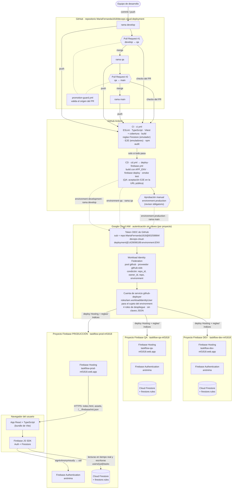

# Entrega final · Taller de despliegue cloud con CI/CD

**Despliegue de aplicaciones e infraestructura en la nube (AWS Amplify · Firebase · Jenkins)**
Electiva: Laboratorio DevOps · Modalidad B (proyecto propio)

| | |
|---|---|
| Proyecto | **TaskFlow**: gestor de tareas web |
| Integrantes | Carlos Daniel Quintero, Geronimo Valencia Gonzalez, Mariana Duarte Castro, Sofia Salgado Osorio, Maria Fernanda Valencia Noreña |
| Repositorio | https://github.com/MariaFernanda1818/devops-cloud-deployment |
| Fecha de verificación | 2026-10-22 |
| Video | **⟦PENDIENTE: enlace al video con permisos de visualización⟧** |

> Documento académico independiente. El detalle técnico completo está en el [README](../README.md); la configuración paso a paso, en [`CONFIGURACION.md`](CONFIGURACION.md); las evidencias, en [`EVIDENCIAS.md`](EVIDENCIAS.md); el guion del video, en [`SUSTENTACION.md`](SUSTENTACION.md).

---

## 1. Resumen

Se desarrolló y desplegó **TaskFlow**, una aplicación web de gestión de tareas (React + TypeScript + Vite) con persistencia real en Cloud Firestore. Está publicada en **tres ambientes independientes** (DEV, QA y PRODUCCIÓN), cada uno en su propio proyecto Firebase y con su propia URL.

Un pipeline de **GitHub Actions** ejecuta análisis estático, pruebas automatizadas, build, despliegue y verificación posterior. Los cambios se promueven entre ambientes con Pull Requests (`develop → qa → main`). El despliegue a producción exige **aprobación manual** en el environment `production`.

El pipeline se autentica en Google Cloud **sin claves permanentes**, mediante Workload Identity Federation (OIDC). Todo funciona en el plan **Spark** de Firebase, sin cuenta de facturación vinculada.

## 2. Objetivos del taller y cumplimiento

| Resultado de aprendizaje | Cómo se cumplió |
|---|---|
| Configurar un repositorio Git y conectarlo con un mecanismo de despliegue | Repositorio en GitHub con workflows de CI/CD que despliegan a Firebase Hosting |
| Publicar la aplicación con su API y base de datos | Frontend en Firebase Hosting; datos en Cloud Firestore con reglas de seguridad (arquitectura serverless, §4) |
| Separar DEV, QA y PDN con configuración y URLs diferenciadas | Tres proyectos Firebase, tres GitHub Environments, tres URLs |
| Ejecutar pruebas y promover cambios de forma controlada | CI con 4 jobs de calidad, smoke test, aceptación E2E en QA, PRs de promoción y aprobación manual en producción |
| Documentar arquitectura, variables, secretos, evidencias y costos | Este documento, el README y `docs/` |

## 3. Formato de entrega del equipo

| Campo | Respuesta del equipo |
|---|---|
| Integrantes | Carlos Daniel Quintero, Geronimo Valencia Gonzalez, Mariana Duarte Castro, Sofia Salgado Osorio, Maria Fernanda Valencia Noreña |
| Modalidad | Proyecto propio (Modalidad B) |
| Plataforma principal | Firebase (Hosting, Cloud Firestore, Authentication) + Google Cloud IAM, con CI/CD en GitHub Actions |
| Repositorio | https://github.com/MariaFernanda1818/devops-cloud-deployment |
| URL DEV | https://taskflow-dev-mf1818.web.app |
| URL QA | https://taskflow-qa-mf1818.web.app |
| URL PDN/Producción | https://taskflow-prod-mf1818.web.app |
| API DEV / QA / PDN | No aplica como API REST propia: el servicio de datos es Cloud Firestore de cada proyecto (`taskflow-dev-mf1818`, `taskflow-qa-mf1818`, `taskflow-prod-mf1818`), accedido con el SDK de Firebase y protegido por reglas de seguridad |
| Base de datos y estrategia de persistencia | Cloud Firestore (Native, Standard, `nam5`), una base por ambiente. Cada usuario tiene un `uid` anónimo y solo accede a `users/{uid}/tasks`. Sin credenciales en el repositorio. |
| Pipeline | https://github.com/MariaFernanda1818/devops-cloud-deployment/actions · producción: [CD #7](https://github.com/MariaFernanda1818/devops-cloud-deployment/actions/runs/39859676964) |
| Video | **⟦PENDIENTE: enlace al video con permisos de visualización⟧** |
| Costos y limpieza | Plan Spark sin facturación; costos potenciales y procedimiento de limpieza en §8 y §9 |

### Ambientes

| Ambiente | Rama | URL | Proyecto Firebase | GitHub Environment | Commit publicado (2026-10-22) |
|---|---|---|---|---|---|
| DEV | `develop` | https://taskflow-dev-mf1818.web.app | `taskflow-dev-mf1818` | `development` | `2a2e390` |
| QA | `qa` | https://taskflow-qa-mf1818.web.app | `taskflow-qa-mf1818` | `qa` | `3514960` |
| PRODUCCIÓN | `main` | https://taskflow-prod-mf1818.web.app | `taskflow-prod-mf1818` | `production` (aprobación manual) | `0fb3f92` |

Los tres ambientes ejecutan el mismo código de aplicación; `2a2e390` solo difiere en el README. Cada sitio publica su versión en `/version.json`.

## 4. Arquitectura

La solución es **serverless**: no hay una API Spring Boot ni servidores propios. El navegador descarga la app desde Firebase Hosting, obtiene la configuración del proyecto en `/__/firebase/init.json`, inicia sesión anónima con Firebase Authentication y lee y escribe en Cloud Firestore mediante el SDK de Firebase. Las **reglas de seguridad** de Firestore autorizan cada operación en el servidor. El taller admite esta variante en la Modalidad B, siempre que se justifique.

| Decisión | Justificación |
|---|---|
| Un proyecto Firebase por ambiente | Aislamiento de datos, usuarios, reglas, cuotas y credenciales |
| Serverless con reglas de seguridad | Sin servidor que operar; la autorización se evalúa en Google |
| Configuración desde `/__/firebase/init.json` | El mismo build sirve en cualquier ambiente, sin variables por ambiente en el repositorio |
| Workload Identity Federation | Credenciales temporales; ninguna clave JSON que pueda filtrarse |

## 5. Pipeline CI/CD y promoción

| Workflow | Función |
|---|---|
| `ci.yml` | ESLint, TypeScript estricto, Vitest con umbral de cobertura, build, reglas de Firestore en emulador, E2E con emuladores y `npm audit` |
| `cd.yml` | En push a `develop`/`qa`/`main` ejecuta la CI y, si pasa, despliega al ambiente de la rama; la creación de una rama no despliega |
| `deploy-firebase.yml` | Build con `APP_ENV`, autenticación OIDC, `firebase deploy` (Hosting + reglas), smoke test y, en QA, aceptación E2E sobre la URL pública |
| `promotion-guard.yml` | En PRs hacia `qa`/`main`, verifica que el origen sea `develop`/`qa` (o `hotfix/*`) |

**Promociones realizadas**

| Paso | Evidencia |
|---|---|
| DEV desplegado y verificado | [CD #3](https://github.com/MariaFernanda1818/devops-cloud-deployment/actions/runs/39813146037) (y redespliegues [CD #8](https://github.com/MariaFernanda1818/devops-cloud-deployment/actions/runs/39881991716) y [CD #10](https://github.com/MariaFernanda1818/devops-cloud-deployment/actions/runs/39882366466) por cambios del README) |
| DEV → QA | [PR #1](https://github.com/MariaFernanda1818/devops-cloud-deployment/pull/1), con [CI #1](https://github.com/MariaFernanda1818/devops-cloud-deployment/actions/runs/39813973370) y [Promotion guard #1](https://github.com/MariaFernanda1818/devops-cloud-deployment/actions/runs/39813973180) en verde |
| QA desplegado con aceptación E2E en la URL pública | [CD #5](https://github.com/MariaFernanda1818/devops-cloud-deployment/actions/runs/39817039305), ejecutado manualmente porque el merge del PR #1 no generó el run por push |
| QA → PRODUCCIÓN | [PR #2](https://github.com/MariaFernanda1818/devops-cloud-deployment/pull/2), con [CI #2](https://github.com/MariaFernanda1818/devops-cloud-deployment/actions/runs/39858134394) y [Promotion guard #2](https://github.com/MariaFernanda1818/devops-cloud-deployment/actions/runs/39858134463) en verde |
| Aprobación manual y despliegue a producción | [CD #7](https://github.com/MariaFernanda1818/devops-cloud-deployment/actions/runs/39859676964), commit `0fb3f92`: el job esperó la aprobación de 21:45:39 a 22:01:55 UTC; aprobación registrada por `MariaFernanda1818` |

**Limitaciones de control, declaradas con transparencia:**
- **No hay protección de ramas ni rulesets** en `develop`, `qa` ni `main` (verificado con la API de GitHub). Los checks se ejecutaron y pasaron en ambos PR antes del merge, pero GitHub no los exige.
- **No hubo separación de funciones** en producción: la misma cuenta fusionó el PR #2, inició CD #7 y aprobó el despliegue (*Prevent self-review* desactivado). La aprobación manual sí fue obligatoria: el environment `production` tiene un revisor requerido y el bypass de administradores desactivado.

**Rollback:** el rollback inmediato se hace desde Firebase Console → Hosting → historial de versiones, y solo afecta al sitio. La reversión completa se hace con `git revert` promovido por PR a través de todo el pipeline. *Run workflow* solo redespliega la punta de la rama de cada environment; no permite elegir un commit anterior.

## 6. Pruebas y resultados

| Suite | Resultado |
|---|---|
| ESLint / TypeScript estricto | 0 errores / sin errores |
| Vitest (unitarias y componentes) | 35/35 · cobertura 98.97 % sentencias, 92.3 % ramas |
| Reglas de seguridad de Firestore (emulador) | 6/6 |
| E2E con Playwright (escritorio y móvil, emuladores) | 4/4 |
| Aceptación E2E contra la URL pública de QA | ✅ en CD #5 |
| `npm audit --omit=dev` | 0 vulnerabilidades |
| Smoke test contra DEV, QA y PRODUCCIÓN | 7/7 en cada ambiente (HTTPS, app, versión y commit, cabeceras de seguridad, sin caché en `index`, SPA y `projectId`) |

El despliegue depende de la CI (`needs: ci`): si un job de CI falla, no se despliega. En el historial no hay un run con pruebas fallidas. [CD #1](https://github.com/MariaFernanda1818/devops-cloud-deployment/actions/runs/39720368963) muestra que un fallo (de autenticación) detuvo el pipeline sin publicar.

## 7. Seguridad

| Aspecto | Medida |
|---|---|
| Secretos | Ninguno en el repositorio; los environments solo guardan identificadores no sensibles |
| Autenticación del pipeline | Workload Identity Federation: condición por `repository_id` (1429098189), `repository_owner_id` (83258884), nombre del repositorio y `environment`; principal con el `sub` OIDC inmutable |
| Mínimo privilegio | `github-deployer` con 4 roles (Hosting Admin, Rules Admin, Datastore Index Admin, Service Usage Consumer); no puede leer datos ni cambiar IAM |
| Datos | Reglas de Firestore: solo el dueño accede; validación de esquema; todo lo demás denegado |
| Transporte y navegador | HTTPS, CSP estricta, HSTS, `X-Frame-Options: DENY`, `nosniff`, verificados por el smoke test |
| Producción | Aprobación obligatoria, sin bypass de administradores, solo la rama `main` |

## 8. Servicios y costos

| Servicio | Uso | Cuota sin costo relevante (Spark) | Costo potencial |
|---|---|---|---|
| GitHub Actions | CI/CD | Runners estándar sin costo en repositorios públicos | Minutos con costo si el repo pasa a privado; *larger runners* siempre se cobran |
| Firebase Hosting | Frontend | 10 GB almacenamiento; transferencia 360 MB/día (precios) · 10 GB/mes (cuotas de Hosting) | En Spark el sitio se deshabilita al exceder; en Blaze se cobra |
| Cloud Firestore | Datos | 1 GiB; 50 000 lecturas, 20 000 escrituras y 20 000 borrados por día; 10 GiB/mes de salida | En Spark se detiene al exceder; en Blaze se cobra |
| Firebase Authentication | Identidad anónima | Incluida en Spark | SMS u otros proveedores de pago requieren Blaze (no se usan) |
| Google Cloud IAM | Cuenta de servicio del pipeline | Sin tarifa publicada en la documentación consultada | Roles amplios aumentarían el riesgo, no el costo |
| Workload Identity Federation | Credenciales temporales para GitHub | Sin tarifa publicada en la documentación consultada | Una condición amplia permitiría accesos no deseados |

El costo esperado **en la configuración actual** (Spark, sin cuenta de facturación) es $0. Vincular una cuenta de facturación convierte el proyecto a Blaze, donde se cobra lo que exceda las cuotas y **las alertas de presupuesto no limitan el gasto**. Fuentes y detalle en el README §8.

## 9. Desactivación y eliminación de recursos

1. **Guardar evidencias:** completar las capturas de `docs/evidencias/`, descargar los logs de CD #5 y CD #7, y capturar el historial de Hosting.
2. **Detener los workflows:** Actions → desactivar CD, CI y Promotion guard (o *Disable actions*); eliminar los environments.
3. **Desactivar Hosting:** `npx firebase hosting:disable --project <id> --force` en los tres proyectos.
4. **Revocar el acceso del pipeline:** eliminar el proveedor `github-oidc`, el pool `github` y la cuenta `github-deployer` en cada proyecto.
5. **Eliminar los proyectos:** `gcloud projects delete <id>`, o desde la consola; se pueden restaurar durante ~30 días.
6. **Comprobar:** las URLs ya no sirven la app, los proyectos aparecen eliminados y no queda ninguna cuenta de facturación vinculada.

Comandos exactos en el README §9.

## 10. Evidencias

| DEV | QA | PRODUCCIÓN |
|---|---|---|
|  |  |  |

| Evidencia | Estado |
|---|---|
| App publicada en DEV, QA y PRODUCCIÓN (insignia y commit visibles) | ✅ `evidencias/dev-desktop.png`, `qa-desktop.png`, `prod-desktop.png`, `prod-mobile.png` |
| Grafo de jobs del pipeline CD #7 | ⟦PENDIENTE: `evidencias/gh-cd7-grafo.png`⟧ |
| Aprobación manual registrada (CD #7) | ⟦PENDIENTE: `evidencias/gh-cd7-aprobacion.png`⟧ |
| Summary con el smoke test de producción | ⟦PENDIENTE: `evidencias/gh-cd7-summary.png`⟧ |
| Aceptación E2E en QA (CD #5) | ⟦PENDIENTE: `evidencias/gh-cd5-aceptacion.png`⟧ |
| Checks del PR #2 | ⟦PENDIENTE: `evidencias/gh-pr2-checks.png`⟧ |
| Environment `production` | ⟦PENDIENTE: `evidencias/gh-env-production.png`⟧ |
| Plan Spark sin facturación | ⟦PENDIENTE: `evidencias/firebase-plan-spark.png`⟧ |

Lista completa e instrucciones en [`EVIDENCIAS.md`](EVIDENCIAS.md).

## 11. Conclusiones y lecciones aprendidas

- Separar los ambientes en **proyectos independientes** simplificó el razonamiento de seguridad: ninguna credencial ni dato cruza entre DEV, QA y producción.
- **Workload Identity Federation** eliminó las claves permanentes. Exigió adaptar el principal al **`sub` OIDC inmutable** que GitHub emite para los repositorios creados después del 15 de julio de 2026.
- Las pruebas contra la infraestructura real revelaron un problema que los emuladores no mostraban: la latencia de la confirmación en los listeners de Firestore. Se corrigió basando el indicador de sincronización en la confirmación de cada escritura.
- La verificación posterior al despliegue (`version.json` + smoke test) permitió afirmar con evidencia qué commit está publicado en cada ambiente.
- **Mejoras pendientes:** protección de ramas con checks obligatorios, un segundo revisor con *Prevent self-review* para lograr separación de funciones, y un ensayo documentado de una CI fallida que bloquee un despliegue.

## 12. Referencias

- Firebase Hosting: https://firebase.google.com/docs/hosting
- Cloud Firestore, cuotas: https://firebase.google.com/docs/firestore/quotas
- Precios de Firebase: https://firebase.google.com/pricing
- Planes de precios de Firebase: https://firebase.google.com/docs/projects/billing/firebase-pricing-plans
- GitHub Actions, referencia OIDC: https://docs.github.com/actions/reference/openid-connect-reference
- Subject claims inmutables (GitHub Changelog): https://github.blog/changelog/2026-04-23-immutable-subject-claims-for-github-actions-oidc-tokens/
- Workload Identity Federation: https://cloud.google.com/iam/docs/workload-identity-federation
- Facturación de GitHub Actions: https://docs.github.com/en/billing/concepts/product-billing/github-actions
